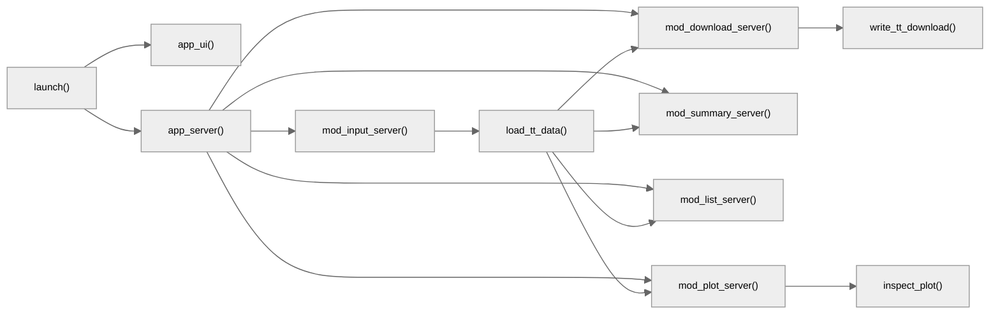
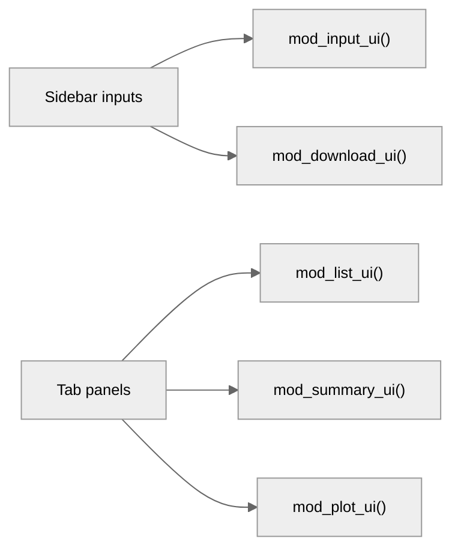
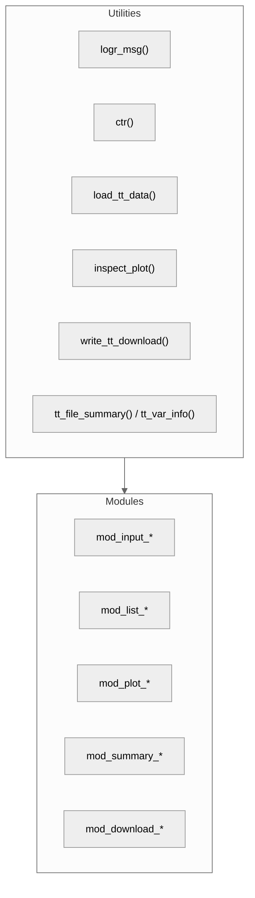
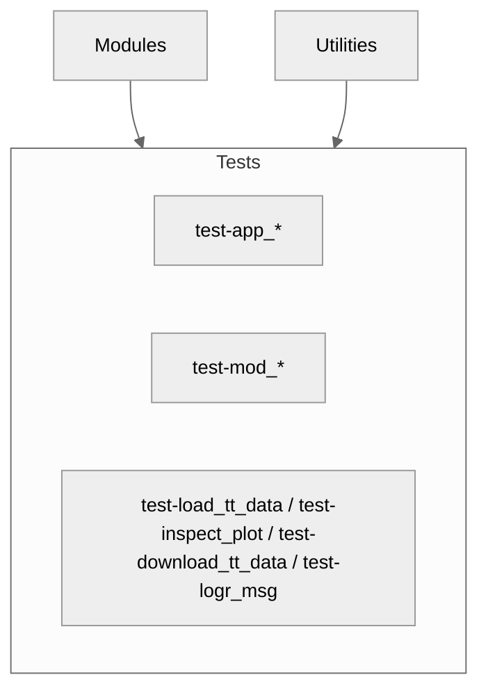

# The \#TidyTuesday data viewer

<!-- badges: start -->

<!-- badges: end -->

The \#TidyTuesday data viewer (`ttdviewer`) is a Shiny app-package[^1]
for viewing data from the [`#TidyTuesday`
project](https://github.com/rfordatascience/tidytuesday). It has the
features below:

1.  The data are loaded directly from GitHub. The index of titles and
    file URLs is built with the
    [`tidytuesdayR`](https://dslc-io.github.io/tidytuesdayR/) and
    [`ttmeta`](https://r4ds.github.io/ttmeta/) packages.
2.  The returned object is visible as a list on the first `nav_panel()`
    via the [`listviewerlite`
    package](https://long39ng.github.io/listviewerlite/).  
3.  The Summary tab shows the number of files, summary statistics,
    variable information (type, missing values, unique values), and the
    data itself (first 1,000 rows) for each file, using the [`reactable`
    package](https://glin.github.io/reactable/).  
4.  Data visualizations from the [`inspectdf`
    package](https://alastairrushworth.com/inspectdf/) ‘*summarise
    missingness, categorical levels, numeric distribution, correlation,
    column types and memory usage*’ are available on the Graphs tab.
5.  The sidebar downloads one file, or all files, as CSV or parquet.
    All files from a title with several files download as one `.zip`.

## Architecture

The app is packaged as a Shiny application with a single entry point
that wires UI and server logic together. The server loads the selected
dataset, routes it through module servers, and then exposes the
reactive outputs to the UI panels.



The UI arranges module outputs into panels while the sidebar hosts the
dataset selector and the data download.



Supporting utilities and tests wrap the core modules. Logging, data
helpers, and download writers are kept in standalone R files, while
`tests/testthat` validates module behavior and data helpers.





## Installation

You can install the development version of `ttdviewer` from
[GitHub](https://github.com/) with:

``` r
# install.packages("pak")
pak::pak("mjfrigaard/ttdviewer")
```

## Launch app

Launch the application using the standalone app function below. By
default `launch()` runs the app in the background and returns a handle,
so the console stays available:

``` r
library(ttdviewer)
handle <- launch()
handle$stop()
```

Use `launch(mode = "run")` to return the app object instead (e.g., in an
`app.R` file for deployment).

[^1]: An R package containing a Shiny application. Read more
    [here](https://mastering-shiny.org/scaling-packaging.html).
